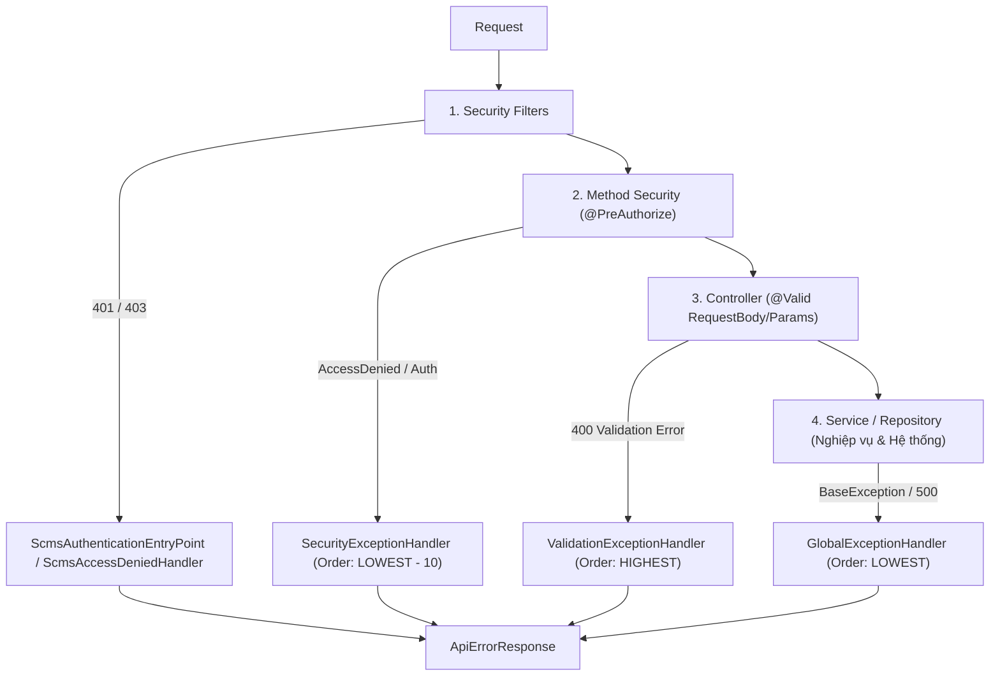

# SCMS – Bộ Quy Tắc Hệ Thống (System Rules & Standards)

> Tài liệu này tổng hợp toàn bộ **Quy tắc kiến trúc, Quy chuẩn lập trình, Chính sách bảo mật, Hợp đồng API và Quy tắc nghiệp vụ (Business Rules)** của dự án **`scms-be`** (đã tách biệt phần thiết kế vật lý Database).
> Mọi thành viên trong đội ngũ phát triển và AI Pair-Programmer **bắt buộc tuân thủ nghiêm ngặt** các quy tắc dưới đây.
> 
> - **Quy chuẩn viết code sạch & Checklist**: Tham khảo song song file [`CODING_RULES.md`](./CODING_RULES.md) (SOLID, Clean Code, PR Checklist).

---

## Mục lục

1. [Quy tắc Kiến trúc & Package (Architectural Rules)](#1-quy-tắc-kiến-trúc--package-architectural-rules)
2. [Quy chuẩn Đặt tên & Lập trình (Coding & Naming Conventions)](#2-quy-chuẩn-đặt-tên--lập-trình-coding--naming-conventions)
3. [Quy tắc Kiểm soát Lỗi & Transaction (Error Handling & Transaction Rules)](#3-quy-tắc-kiểm-soát-lỗi--transaction-error-handling--transaction-rules)
4. [Quy tắc Logging & Audit (Logging & Audit Rules)](#4-quy-tắc-logging--audit-logging--audit-rules)
5. [Quy tắc Bảo mật & Phân quyền (Security & Access Control Rules)](#5-quy-tắc-bảo-mật--phân-quyền-security--access-control-rules)
6. [Quy ước Hợp đồng API (API Contract Rules)](#6-quy-ước-hợp-đồng-api-api-contract-rules)
7. [Danh mục Quy tắc Nghiệp vụ Trọng yếu (Business Rules: BR-01 → BR-53)](#7-danh-mục-quy-tắc-nghiệp-vụ-trọng-yếu-business-rules-br-01--br-53)

---

## 1. Quy tắc Kiến trúc & Package (Architectural Rules)

### 1.1. Cấu trúc Package chuẩn (`edu.fpt.sba.scms`)

Dự án áp dụng mô hình phân tầng **Layered Architecture kết hợp Hexagonal Ports/Adapters**. Không được tự ý tạo package nằm ngoài cấu trúc chuẩn sau:

| Package | Mục đích | Ràng buộc phụ thuộc (Dependency Rule) |
|---|---|---|
| `config` | Composition root, cấu hình Bean, Web filter chain, Security. | Được import các tầng để nối dây; **cấm** các tầng khác import `config` (trừ ngoại lệ `TraceContextFilter` và `AppProperties`). |
| `common` | Tiện ích, Enum, Exception base, Audit, Trace, Criteria specifications. | **Độc lập tuyệt đối**: CẤM import bất kỳ package nội bộ nào khác của ứng dụng. |
| `dto` | Data Transfer Object (Request, Response, Query). | Chỉ được phụ thuộc `common` và JDK. CẤM import `controller`, `service`, `repository`, `model`. |
| `controller` | Điểm tiếp nhận HTTP Request (`@RestController`). | Chỉ được gọi `service` (interface), `dto`, `security` (chỉ `UserPrincipal`), `common`. CẤM gọi `repository`, `model`, `mapper`. |
| `service` | Khai báo Interface nghiệp vụ; `service.impl` triển khai và quản lý `@Transactional`. | Được import `domain`, `repository`, `model`, `dto`, `mapper`, `integration`, `common`. CẤM import `controller` hoặc `security.filter`. |
| `domain` | Chứa logic nghiệp vụ tính toán thuần (Pure Java). | **Chỉ dùng JDK** (không dùng Spring, không dùng JPA annotations). |
| `mapper` | Chuyển đổi qua lại giữa Entity $\leftrightarrow$ DTO (MapStruct). | Chỉ import `model` và `dto`. CẤM gọi `service`, `repository`. |
| `repository` | Spring Data JPA Repository và JpaSpecificationExecutor. | Chỉ phụ thuộc `model` và `common` (để đọc `BranchContext`). CẤM gọi `service`, `controller`. |
| `model` | Các JPA Entities. | Chỉ import `common/enums`. CẤM import DTO, Service hay Repository. |
| `security` | JWT Provider, Security Filters, BranchContext, UserPrincipal. | Chỉ phụ thuộc `repository`, `model` (chỉ `User`), `common`, `dto`, `config.properties`. |
| `integration`| Cổng tích hợp dịch vụ bên ngoài (SePay, VietQR, Printer). | Sử dụng mô hình Port/Adapter, chỉ phụ thuộc `common`, `config.properties`. |

> [!IMPORTANT]
> Toàn bộ quy tắc phụ thuộc trên được **kiểm tra tự động bằng ArchUnit** tại `src/test/java/edu/fpt/sba/scms/architecture/ArchitectureTest.java`. Mọi vi phạm import sẽ khiến lệnh `./mvnw test` thất bại ngay lập tức.

### 1.2. Quy tắc Môi trường (Environment Rules)

* **Profile bắt buộc set tường minh**: Ứng dụng **không có profile mặc định**. Khởi động luôn phải truyền `SPRING_PROFILES_ACTIVE=dev` (hoặc `test`, `prod`).
* **Quy tắc Prod Fail-Fast**: Tại môi trường `prod`, class `ProdConfigGuard` sẽ quét toàn bộ cấu hình. Ứng dụng sẽ tự hủy (throw exception chặn start) nếu:
  1. Thiếu các biến môi trường bắt buộc: `JWT_ACCESS_SECRET`, `JWT_REFRESH_SECRET`, `DB_HOST`, `DB_PASSWORD`, `KIOSK_PIN_PEPPER`.
  2. Bật cờ seed dữ liệu mẫu (`app.auth.seed.enabled=true`).
  3. Bật cờ Swagger UI (`OPENAPI_ENABLED=true`).
  4. Cookie refresh không bật cờ `Secure=true`.
  5. Cấu hình kết nối MySQL không đạt chuẩn TLS (`sslMode` không thuộc `REQUIRED` / `VERIFY_CA` / `VERIFY_IDENTITY`).

---

## 2. Quy chuẩn Đặt tên & Lập trình (Coding & Naming Conventions)

### 2.1. Quy tắc Đặt tên (Naming Rules)

* **Class / Interface / Enum**: Dùng `PascalCase`.
  * Controller: `<TênDomain>Controller` (vd: `AuthController`, `ProductController`).
  * Service Interface: `<TênDomain>Service` (vd: `CategoryService`).
  * Service Implementation: `<TênDomain>ServiceImpl` (vd: `CategoryServiceImpl`).
  * Repository: `<TênEntity>Repository` (vd: `UserRepository`).
  * Specification: `<TênEntity>Specs` (vd: `ProductSpecs`).
  * Mapper: `<TênEntity>Mapper` (vd: `CategoryMapper`).
  * DTO Request: `Save<Domain>Request`, `Create<Domain>Request`, `Update<Domain>Request`.
  * DTO Query: `<Domain>ListQuery`.
  * DTO Response: `<Domain>Dto`, `<Domain>DetailDto`, `<Action>Response`.
  * Exception: `<NguyênNhân>Exception` (vd: `NotFoundException`, `ConflictException`).
* **Method / Field**: Dùng `camelCase` (vd: `findActiveProducts`, `branchId`).
* **Constant / Enum Value**: Dùng `UPPER_SNAKE_CASE` (vd: `AUTH_REQUIRED`, `ORDER_CANCEL`).

### 2.2. Quy chuẩn Viết Code

* **Java 21 Standards**:
  * Sử dụng `record` cho tất cả các DTO (Request, Response, Query).
  * Ưu tiên Pattern Matching cho `switch` và `instanceof`.
* **MapStruct**: Sử dụng annotation `@Mapper(componentModel = "spring")`. Tuyệt đối không trả JPA Entity trực tiếp ra Controller; mọi dữ liệu ra API phải map qua DTO.
* **Controller sạch**: Controller chỉ làm nhiệm vụ nhận request, validate cú pháp (`@Valid`), ủy quyền cho `Service`, và trả kết quả. Controller không chứa business logic hay query DB.

---

## 3. Quy tắc Kiểm soát Lỗi & Transaction (Error Handling & Transaction Rules)

### 3.1. Mô hình Xử lý Lỗi 4 Lớp

Mọi lỗi ném ra từ bất kỳ đâu trong hệ thống phải đi qua 1 trong 4 lớp kiểm soát tập trung sau (tuyệt đối không để lộ stack trace thô ra ngoài):



1. **Lớp 1 - Filter Chain Security**: `ScmsAuthenticationEntryPoint` (401) và `ScmsAccessDeniedHandler` (403) xử lý lỗi trước khi request chạm tới `DispatcherServlet`.
2. **Lớp 2 - Controller Method Security**: `SecurityExceptionHandler` bắt các lỗi quyền truy cập ở mức method security.
3. **Lớp 3 - Input Validation**: `ValidationExceptionHandler` gom toàn bộ lỗi `@Valid`, `ConstraintViolationException`, `MissingServletRequestParameterException` thành mảng `fieldErrors` chi tiết `{ field: "...", message: "..." }`.
4. **Lớp 4 - Nghiệp vụ chung**: `GlobalExceptionHandler` bắt toàn bộ exception kế thừa `BaseException`, lỗi đồng thời `OptimisticLockingFailureException` (map về 409), và lỗi chưa định danh (500 masked message).

### 3.2. Cây Thừa kế Exception Bắt buộc

Mọi exception nghiệp vụ tự định nghĩa **bắt buộc kế thừa `BaseException`**:

```
BaseException (RuntimeException)
├── UnauthorizedException (401: AUTH_REQUIRED, AUTH_TOKEN_EXPIRED, INVALID_CREDENTIALS...)
├── ForbiddenException (403: ACCESS_DENIED, CROSS_BRANCH_DENIED...)
├── NotFoundException (404: RESOURCE_NOT_FOUND...)
├── ConflictException (409: RESOURCE_CONFLICT, DUPLICATE_CODE, INVALID_STATE_TRANSITION...)
├── BusinessRuleException (422: VOUCHER_EXPIRED, INSUFFICIENT_STOCK, SHIFT_NOT_OPEN...)
├── ValidationException (400: VALIDATION_ERROR, INVALID_INPUT_PAYLOAD...)
└── IntegrationException (503: INTEGRATION_UNAVAILABLE...)
```

### 3.3. Quy tắc Quản lý Giao dịch (Transaction Rules)

* **Vị trí**: Chỉ đặt `@Transactional` ở tầng `Service` (Interface hoặc `ServiceImpl`). Không đặt `@Transactional` trên Controller hay Repository.
* **Tối ưu Đọc (Read)**: Mọi phương thức chỉ đọc dữ liệu bắt buộc khai báo `@Transactional(readOnly = true)`.
* **Giao dịch Ghi (Write)**: Mọi phương thức thêm/sửa/xóa phải có `@Transactional(rollbackFor = Exception.class)`.
* **Kiểm soát đồng thời (Concurrency Control)**:
  * **Optimistic Locking**: Các bảng có trường `row_version` (như `sales_order`, `inventory`, `shift`, `app_user`) dùng `@Version`. Khi có 2 thao tác ghi đồng thời, giao dịch đến sau sẽ bị từ chối với HTTP 409 `INVALID_STATE_TRANSITION`.
  * **Pessimistic Locking**: Khi thao tác trừ tồn kho, nạp/rút tiền ngăn kéo, bắt buộc dùng `@Lock(LockModeType.PESSIMISTIC_WRITE)` để khóa bản ghi trong DB.
  * **Cập nhật nguyên tử**: Ví dụ thu hồi token trong bảng `auth_token` dùng câu lệnh `UPDATE ... WHERE revoked_at IS NULL` để đảm bảo race condition giữa các request đồng thời chỉ có 1 request thành công.

---

## 4. Quy tắc Logging & Audit (Logging & Audit Rules)

### 4.1. Quy tắc Traceability (Dấu vết Request)

* Mọi request đi qua server bắt buộc được gán một **Trace ID** qua `TraceContextFilter` (đọc từ header `X-Trace-Id` hoặc tự sinh UUIDv4).
* `Trace ID` được nạp vào SLF4J `MDC` cùng với `userId` và `branchId` (sau khi xác thực).
* Header `X-Trace-Id` luôn được trả về trên HTTP Response của cả request thành công lẫn request lỗi.
* Khi gọi task bất đồng bộ (`@Async`), context MDC bắt buộc phải được copy sang thread mới thông qua `MdcTaskDecorator`.

### 4.2. Quy tắc Phân loại Mức Log

* **`ERROR`**: Lỗi hệ thống, crash không mong muốn (500), mất kết nối Database hoặc cổng thanh toán bên thứ ba (SePay, VietQR).
* **`WARN`**: Lỗi nghiệp vụ bị từ chối (422, 409), xác thực thất bại (401), cố tình truy cập trái phép (403), rate-limit vượt ngưỡng.
* **`INFO`**: Sự kiện chuyển trạng thái kinh doanh quan trọng: Đăng nhập/đăng xuất, Mở/đóng ca làm việc, Đổi trạng thái đơn hàng (PAID, REFUNDED), Nhập/xuất kho.
* **`DEBUG`**: Chỉ dùng ở môi trường `dev` để kiểm tra luồng, query DB.

### 4.3. Quy tắc Bảo mật Dữ liệu Log (Data Masking)

* **CẤM TUYỆT ĐỐI**: Không bao giờ log thông tin mật ở dạng plain-text (Mật khẩu, PIN chấm công, JWT token đầy đủ, mã bí mật webhook).
* **Số tài khoản ngân hàng**: Chỉ được log 4 số cuối (vd: `******1234`).
* **Webhook payload**: Chỉ log kích thước bytes và mã tham chiếu (reference id).

### 4.4. Quy tắc Ghi Log ra File

* Sử dụng **Logback RollingFileAppender** kết hợp `SizeAndTimeBasedRollingPolicy`:
  * Xoay vòng file log theo ngày và dung lượng tối đa **10MB/file**, tự động nén gzip (`.gz`).
  * Thời gian lưu trữ tối đa: **30 ngày**, giới hạn tổng dung lượng thư mục log: **3GB**.
  * Môi trường `prod` bắt buộc dùng format **JSON (LogstashEncoder)** để phục vụ tích hợp ELK / Grafana Loki / CloudWatch.

### 4.5. Quy tắc Ghi Nhật ký Kiểm toán (Audit Log)

* Mọi thao tác thay đổi dữ liệu nhạy cảm (phân quyền, đổi role, sửa giờ công, hủy đơn, refund, nạp/rút tiền, kiểm kê kho) bắt buộc gọi `AuditLogService.log(...)`.
* **Tính đồng bộ**: Audit log phải được ghi **trong cùng một transaction nghiệp vụ** để đảm bảo tính nhất quán (nếu nghiệp vụ rollback thì audit rollback, trừ trường hợp đặc biệt).
* **Tính bất biến**: Bảng `audit_log` là bất biến (DB có trigger chặn `UPDATE` và `DELETE`).

---

## 5. Quy tắc Bảo mật & Phân quyền (Security & Access Control Rules)

### 5.1. Mô hình Xác thực (Authentication)

* **Stateless JWT**: Sử dụng thuật toán HS256 với secret tối thiểu 32 ký tự (256-bit).
  * Access Token: Hạn sống 30 phút, chứa claims: `uid`, `sub`, `name`, `role`, `bid` (branchId), `jti`, `typ`.
  * Refresh Token: Hạn sống 7 ngày (hoặc 12 giờ cho phiên không remember me), lưu mã hash SHA-256 trong bảng `auth_token`.
* **Refresh Rotation**: Mỗi khi dùng Refresh Token để đổi cặp token mới, Refresh Token cũ bị thu hồi ngay lập tức (`revoked_at`). Nếu phát hiện một token đã bị thu hồi được sử dụng lại $\rightarrow$ Lập tức thu hồi toàn bộ session của tài khoản đó.
* **Kiosk Authentication**: Thiết bị chấm công tại chi nhánh không dùng JWT mà xác thực qua API Key truyền trên header `X-Kiosk-Key` (`KioskKeyFilter`).

### 5.2. Chống Tấn công Dò quét (Brute-Force & Timing Attack)

* **Khóa tài khoản**: Đăng nhập sai mật khẩu hoặc PIN 5 lần liên tiếp trong 15 phút $\rightarrow$ Tạm khóa 15 phút (`AccountLockedException`).
* **Rate Limit IP**: Tối đa 10 lần thử đăng nhập sai / 5 phút từ một IP $\rightarrow$ Chặn IP đó 5 phút (trả HTTP 429 kèm header `Retry-After`).
* **Chống Timing Attack (User Enumeration)**: Sử dụng chuỗi `dummyPasswordHash` để luôn thực thi hàm băm BCrypt ngay cả khi username không tồn tại trong DB, giữ thời gian phản hồi đồng đều giữa username đúng và sai.

### 5.3. Quy tắc Phân quyền (RBAC) & Cô lập Chi nhánh (Branch Scope Isolation)

Dự án có 4 role cố định: `COO`, `BRANCH_MANAGER`, `CASHIER`, `STAFF`.

| Role | Phạm vi truy cập (Branch Scope) | Kênh truy cập |
|---|---|---|
| **`COO`** | Toàn chuỗi. `branchId` trong Token là `null`. Được phép chỉ định `branchId` qua query params để xem dữ liệu từng chi nhánh. | Web Admin Portal |
| **`BRANCH_MANAGER`** | Chỉ giới hạn trong chi nhánh được phân công. `branchId` lấy cố định từ Token JWT. Cấm truy cập chéo sang chi nhánh khác (`CROSS_BRANCH_DENIED`). | Web Admin Portal |
| **`CASHIER`** | Chỉ trong chi nhánh được phân công. Bắt buộc có ca mở mới được thao tác POS. | Web POS Terminal |
| **`STAFF`** | Không cấp tài khoản đăng nhập Web/POS. Chỉ tương tác qua máy Kiosk. | Kiosk Terminal (`X-Kiosk-Key`) |

---

## 6. Quy ước Hợp đồng API (API Contract Rules)

### 6.1. Envelope Phản hồi Thành công (`ApiResponse<T>`)

Tất cả các API RESTful (trừ các endpoint stream file, xuất Excel/CSV) đều trả về định dạng bọc thống nhất:

```json
{
  "success": true,
  "status": 200,
  "code": "SUCCESS",
  "message": "OK",
  "data": { },
  "timestamp": "2026-11-06T14:15:00.000Z",
  "traceId": "c4b12389e4..."
}
```

> [!NOTE]
> Class `ApiResponseAdvice` (`ResponseBodyAdvice`) sẽ **tự động đóng gói** DTO trả về từ Controller vào envelope này. Lập trình viên không cần đóng gói thủ công trong Controller.

### 6.2. Envelope Phản hồi Thất bại (`ApiErrorResponse`)

```json
{
  "success": false,
  "status": 400,
  "code": "VALIDATION_ERROR",
  "message": "Dữ liệu đầu vào không hợp lệ.",
  "path": "/api/v1/menu-categories",
  "timestamp": "2026-11-06T14:15:00.000Z",
  "traceId": "c4b12389e4...",
  "fieldErrors": [
    {
      "field": "name",
      "message": "Tên danh mục không được để trống."
    }
  ]
}
```

### 6.3. Chuẩn Hóa Dữ liệu Trao đổi (Data Types & Formats)

* **Thời gian**: Trả về chuẩn **ISO-8601 UTC** (`yyyy-MM-dd'T'HH:mm:ss.SSS'Z'`). Giờ hiển thị phía Client do Frontend tự convert theo múi giờ `Asia/Ho_Chi_Minh`.
* **Tiền tệ**: Mọi trường số tiền lưu và trao đổi dưới dạng số nguyên VND `decimal(19,0)` hoặc `Long`. Không sử dụng số thực `float`/`double`. Định dạng hiển thị dùng `MoneyUtil` (vd: `125.000 ₫`).
* **Idempotency**: Đối với API tạo đơn hàng (`POST /api/v1/orders`), Client bắt buộc gửi header `Idempotency-Key` (UUIDv4) để chống tạo đơn trùng lặp khi mạng chập chờn.

---

## 7. Danh mục Quy tắc Nghiệp vụ Trọng yếu (Business Rules: BR-01 → BR-53)

Dưới đây là các Business Rules nghiệp vụ bắt buộc phải hiện thực trong code (tương ứng với đặc tả trong `IMPLEMENTATION.md §9`):

### Nhóm 1: Xác thực, Phân quyền & Nhân sự (BR-01 → BR-15)

* **BR-01**: Đăng nhập và phân quyền tự động theo Role và phạm vi Chi nhánh (`branch_id`).
* **BR-02**: Chỉ duy nhất tài khoản `COO` mới có quyền gán/thay đổi Role của nhân sự (`PUT /api/v1/users/{id}/role`). Mọi thay đổi phải ghi Audit `ROLE_ASSIGN`.
* **BR-03**: Branch Manager (BM) không được tự duyệt giờ công, thưởng, phạt hoặc bảng lương của chính mình (`SELF_APPROVAL_FORBIDDEN`). Khi duyệt lương cho BM, bắt buộc phải do COO phê duyệt.
* **BR-04 (Cô lập dữ liệu chi nhánh)**: Tất cả query của BM và Cashier bắt buộc tự động gắn điều kiện `branch_id = BranchContext.requireBranchId()`.
* **BR-05**: Một thẻ RFID chỉ được gán cho duy nhất 1 nhân viên đang ở trạng thái `ACTIVE`.
* **BR-06**: Quét thẻ tại Kiosk: Nếu nhân viên chưa có bản ghi chấm công mở $\rightarrow$ Tự động Check-in; nếu đã có $\rightarrow$ Tự động Check-out (phải tuân thủ khoảng cách tối thiểu BR-07).
* **BR-07**: Khoảng cách tối thiểu giữa lần Check-in và Check-out phải $\ge 15$ phút (`ATTENDANCE_MIN_INTERVAL`).
* **BR-08**: Quẹt thẻ thất bại có thể fallback bằng mã PIN 4 số. Nhập sai PIN 5 lần liên tiếp $\rightarrow$ Khóa tính năng chấm công bằng PIN 5 phút.
* **BR-09 (Quên Check-out)**: Hệ thống chạy Scheduled Job mỗi 15 phút. Bản ghi chấm công mở quá 14 giờ sẽ tự động đánh dấu cờ `forgot_checkout = true` và treo tính lương của ca đó cho tới khi BM can thiệp.
* **BR-10**: Chỉ Branch Manager mới có quyền điều chỉnh giờ công chấm công của nhân viên kèm lý do bắt buộc. Không được điều chỉnh bản ghi đã chốt trong kỳ lương (`pay_period`).
* **BR-11**: Chỉ COO mới có quyền tạo mới, cập nhật thông tin hoặc ngưng hoạt động một Chi nhánh.
* **BR-12**: Mỗi tài khoản BM chỉ thuộc về 1 chi nhánh tại một thời điểm. Chỉ COO mới có quyền điều chuyển BM sang chi nhánh khác (`MANAGER_REASSIGN`). Lịch sử dữ liệu cũ của chi nhánh trước không bị thay đổi.
* **BR-13 (Không xóa cứng)**: Tuyệt đối không xóa vật lý (hard delete) bản ghi nhân viên. Khi nghỉ việc chỉ đổi trạng thái `status = INACTIVE`.
* **BR-14**: Mức lương giờ mới (`WageRate`) chỉ có hiệu lực cho các ca làm việc trong tương lai, không áp dụng hồi tố cho các ca đã diễn ra.
* **BR-15**: Không cho phép xếp lịch ca làm việc (`ShiftAssignment`) trùng khoảng thời gian cho cùng một nhân viên (`ScheduleConflictException`).

### Nhóm 2: Menu, Sản phẩm & Khuyến mãi (BR-16 → BR-23)

* **BR-16**: Menu, danh mục, sản phẩm, size, topping và công thức định lượng (BOM) do COO quản lý tập trung. Chi nhánh không được tự ý thêm bớt sản phẩm.
* **BR-17**: Sản phẩm có trạng thái `UNAVAILABLE` hoặc bị chi nhánh tạm ngưng bán (`branch_product_availability.is_available = false`) sẽ tự động bị ẩn khỏi màn hình POS.
* **BR-18**: Giá sản phẩm được cấu hình theo từng Size bởi COO.
* **BR-19**: Định lượng công thức pha chế (Recipe/BOM) chỉ do COO thiết lập.
* **BR-20**: Chương trình khuyến mãi và Voucher do COO tạo và quản lý tập trung.
* **BR-21**: Mỗi đơn hàng chỉ được áp dụng **duy nhất 1 Voucher**. Tổng tiền sau giảm giá không được âm ($\ge 0$).
* **BR-22**: Voucher chỉ được áp dụng khi thỏa mãn toàn bộ điều kiện: Còn hạn sử dụng, đạt giá trị đơn tối thiểu, chưa vượt giới hạn lượt dùng, và đúng đối tượng áp dụng (Category/Product).
* **BR-23 (Master Data Version)**: Sau khi COO chỉnh sửa Menu/Giá, phải thực hiện hành động Publish để sinh `MasterDataVersion` mới. Đơn hàng đã tạo trước đó giữ nguyên snapshot giá cũ.

### Nhóm 3: Bán hàng POS & Đơn hàng (BR-24 → BR-31)

* **BR-24**: Tiền chuyển khoản thanh toán đơn hàng phải chuyển trực tiếp vào tài khoản ngân hàng chính thức của chuỗi.
* **BR-25**: Mỗi dòng món trong đơn hàng (`OrderLine`) bắt buộc phải có đầy đủ thông tin: Size, Mức đường, Mức đá, Danh sách Topping (nếu có), và Ghi chú.
* **BR-26 (Đóng băng đơn hàng)**: Đơn hàng sau khi chuyển trạng thái `PAID` (Đã thanh toán) sẽ bị đóng băng hoàn toàn. Mọi sửa đổi món hay hủy đơn sau thanh toán bắt buộc phải đi qua quy trình Hoàn tiền (Refund).
* **BR-26b**: Thu ngân có quyền hủy đơn hàng ở trạng thái `PENDING` (chưa thanh toán) với lý do hủy bắt buộc. Thao tác này không sinh giao dịch hoàn tiền.
* **BR-27**: Tiền mặt thu từ đơn hàng `PAID` sẽ tự động ghi nhận vào doanh thu tiền mặt của ca làm việc hiện tại (`shift.cash_revenue`).
* **BR-28**: Mã VietQR động tạo ra phải chứa đúng số tài khoản, số tiền chính xác của đơn, và cú pháp nội dung `CAFE<mã_đơn>`.
* **BR-29 & BR-30**: Đơn hàng thanh toán QR chỉ chuyển sang `PAID` khi nhận Webhook từ SePay khớp chính xác: Mã đơn hàng, Số tiền, và Chữ ký hợp lệ. Nếu lệch tiền hoặc sai chữ ký, đơn hàng vẫn giữ `PENDING` và kích hoạt cảnh báo.
* **BR-31**: Phiếu pha chế (Preparation Slip) và Hóa đơn (Receipt) chỉ được in sau khi đơn hàng đã chuyển trạng thái `PAID`.

### Nhóm 4: Ngăn kéo tiền, Ca làm việc & Hoàn tiền (BR-32 → BR-39)

* **BR-32 (Quy tắc 2 người duyệt)**: Các thao tác nhạy cảm (Rút tiền mặt giữa ca, Hoàn tiền đơn hàng) do Thu ngân khởi tạo nhưng bắt buộc phải có **Mã PIN xác thực của Branch Manager**.
* **BR-33 & BR-34**: Tiền hoàn trả khách hàng (Refund) luôn chi bằng tiền mặt và trừ trực tiếp từ ngăn kéo tiền mặt của ca hiện tại.
* **BR-35**: Nếu số tiền hoàn trả hoặc số tiền điều chỉnh vượt quá hạn mức cấu hình (`threshold.refund.vnd`), yêu cầu bắt buộc phải chuyển lên cho COO phê duyệt.
* **BR-36**: Mỗi chi nhánh tại một thời điểm chỉ được phép có **duy nhất 1 Ca làm việc mở** (`status = 'OPEN'`). Bắt buộc phải mở ca và nhập số tiền đầu ca mới được phép tạo đơn trên POS.
* **BR-37**: Thao tác Nạp tiền (`CASH_IN`) hoặc Rút tiền (`CASH_OUT`) khỏi ngăn kéo phải nhập lý do rõ ràng và có xác thực của BM.
* **BR-38**: Khi Đóng ca (`Close Shift`), Thu ngân phải nhập số tiền thực tế đếm được. Nếu có chênh lệch so với số tiền lý thuyết, bắt buộc phải nhập lý do giải trình.
* **BR-39 (Công thức tiền mặt lý thuyết)**:
  $$\text{Expected Cash} = \text{Tiền đầu ca} + \text{Doanh thu tiền mặt (PAID)} + \text{Cash In} - \text{Cash Out} - \text{Tiền Refund}$$

### Nhóm 5: Quản lý Kho & Kiểm kê (BR-40 → BR-45)

* **BR-40**: Hàng hóa nhập kho (`RECEIVE`) được nhập theo đơn vị đóng gói lớn (`pack_unit`), hệ thống tự động quy đổi ra đơn vị cơ sở (`base_unit`) để trừ kho theo công thức pha chế.
* **BR-41**: Tồn kho chi nhánh chỉ trừ khi thực hiện phiếu xuất kho cho quầy Bar theo kiện nguyên; việc bán từng ly đồ uống tại POS không trừ tồn kho vật lý tức thời.
* **BR-42**: Số lượng hàng xuất kho hoặc hủy hàng không được vượt quá số lượng tồn kho khả dụng hiện tại.
* **BR-43**: Mọi phiếu hủy hàng hỏng/hết hạn (`DISPOSAL`) bắt buộc phải có lý do chi tiết và tải lên ảnh bằng chứng (`evidence_file_id`).
* **BR-44**: Khi hoàn thành Kiểm kê kho (`Stocktake`), hệ thống tự động điều chỉnh tồn sổ khớp theo số đếm thực tế và ghi nhận chênh lệch vào lịch sử giao dịch.
* **BR-45**: Khi tồn kho giảm xuống dưới ngưỡng an toàn (`current_qty_base <= safety_stock_level`), hệ thống tự động kích hoạt cờ cảnh báo `low_stock_flag = true` và bắn cảnh báo tới BM.

### Nhóm 6: Báo cáo, Hao hụt & Lương (BR-46 → BR-53)

* **BR-46 → BR-50**: Báo cáo doanh thu chỉ tổng hợp trên các đơn hàng đã thanh toán (`PAID`). Dữ liệu xuất báo cáo Excel/CSV phải khớp 100% với số liệu hiển thị trên màn hình.
* **BR-51**: Tất cả các hành động xuất báo cáo, thay đổi cấu hình, can thiệp tài chính đều phải được ghi nhật ký kiểm toán bất biến (`AuditLog`).
* **BR-52 (Công thức tính hao hụt nguyên liệu)**:
  $$\text{Hao hụt (Shrinkage)} = \text{Tổng xuất kho quầy Bar (base)} - \sum (\text{Định lượng BOM} \times \text{Số lượng bán PAID})$$
* **BR-53 (Vòng đời Bảng lương)**: Bảng lương vận hành qua các trạng thái: `DRAFT` $\rightarrow$ `SUBMITTED` $\rightarrow$ `APPROVED` $\rightarrow$ `PAID`. Tiền lương thực nhận:
  $$\text{Lương Net} = (\text{Số giờ công thực tế} \times \text{Lương giờ}) + \text{Thưởng} - \text{Phạt/Khấu trừ}$$

---
*Tài liệu này được biên soạn và bảo trì định kỳ cho dự án SCMS Backend.*
